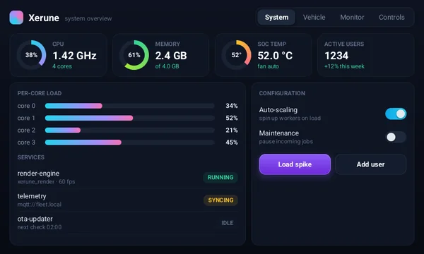
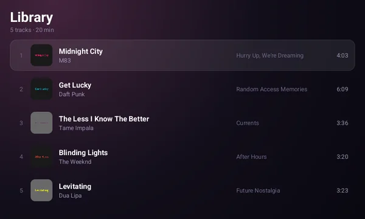
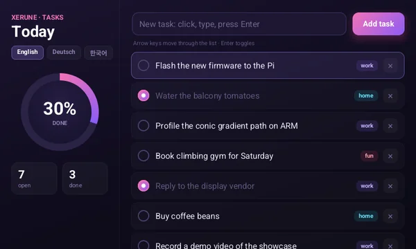
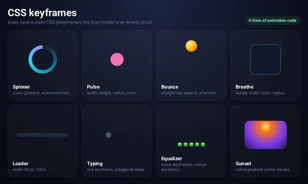
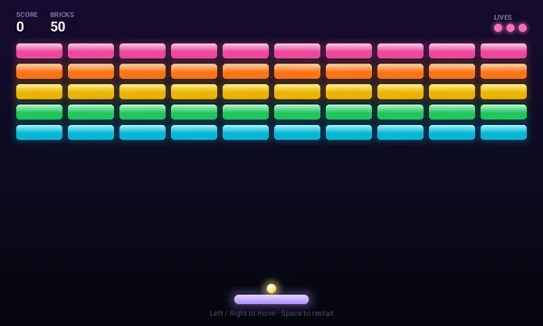
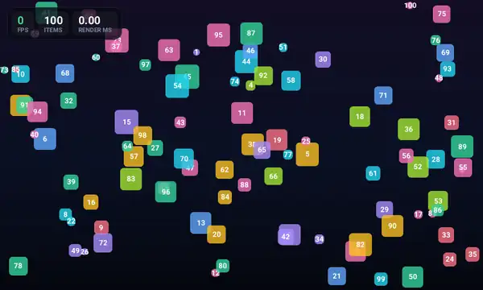
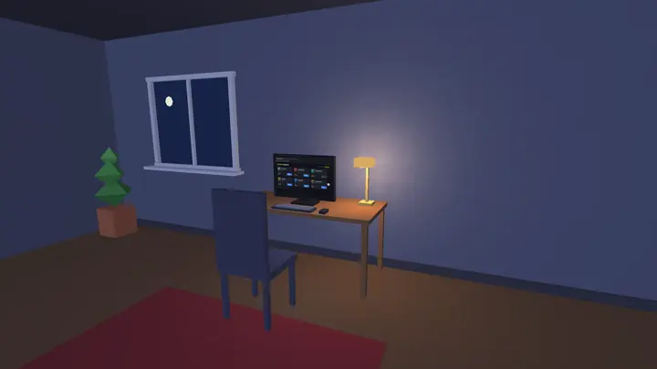

# Xerune

Xerune is a lightweight, CPU-only native HTML/CSS rendering engine and UI framework designed for embedded Linux environments (like Raspberry Pi, QEMU, or custom board systems) without GPU/OpenGLES acceleration.

## Demos

| Showcase | Music player |
| :---: | :---: |
|  |  |
| **Todo** | **CSS keyframes** |
|  |  |
| **Breakout** | **Animation stress test** |
|  |  |

Every example targets an 800x480 panel and has a portrait layout. The clips
are rendered headlessly by Xerune itself, frame by frame on a simulated clock
(`tools/record-demos.sh`), with the same renderer the boards use.

### In a game, through the C API



A C program shows a web shop on an in-game PC. Xerune renders the page into
a texture and reports which part changed. The crosshair's hit on the screen
becomes pointer input, and Buy sends `buy:<id>` back to the program, which
updates its JSON model. The room is drawn by [raylib](https://www.raylib.com)
on the GPU; the screen's content is Xerune. Source:
[`xerune_capi/examples/raylib`](xerune_capi/examples/raylib/pc.c).

## Features

- **Model-View-Update (MVU) Architecture**: Elm-style design providing predictable state transitions and unidirectional data flow.
- **Compile-time template verification**: Native type-safe data binding and layout generation.
- **No GPU required**: High-performance CPU-only rendering.
- **Embedded hardware-ready**: Dedicated backends for Linux Framebuffer (`/dev/fb0`) and DRM/KMS with double buffering.
- **Input integration**: Built-in support for mouse, keyboard, and `evdev` touch input bounds calibration.
- **CSS Stylesheets, Animations & Transitions**: Parse inline styles, global styles, classes, IDs, gradients, borders, font weights, keyframe animations and transitions.
- **Text like Chromium**: Line breaking (UAX #14) checked against Chromium's breaks, `white-space`, `overflow-wrap`, `word-break`, `text-overflow: ellipsis`, `line-height`, and glyphs from fallback fonts (Hangul).
- **Interaction**: `:hover`, `:active`, `:checked`, form controls drawn like Chromium (`accent-color`, `appearance: none`, `::placeholder`), and element keys that keep animation and transition state across rebuilds.
- **On-screen keyboard**: A full-screen keyboard for touch or D-pad devices, with English, German and Korean (Hangul composition) layouts.
- **Translations**: Per-language string catalogs, with the language picked from the POSIX locale.
- **Responsive Layout**: `@media` queries (width/height/orientation), `vw`/`vh`/`vmin`/`vmax` viewport units, automatic `Model::on_resize` notification, and breakpoint helpers — compiled into cheap static guards for embedded targets.
- **Fingerprint Gating**: Opt-in `Model::view_fingerprint` lets the runtime skip full view rebuilds when a message changes no rendered state.
- **Canvas APIs**: Support for custom user-drawn Canvas pixel buffers.
- **C API**: Templates read at run time, models as JSON and messages as strings, drawn into the caller's pixel buffer; for C, C++, Zig and anything that calls C (guide §14).
- **Headless snapshots and recordings**: Any app renders to PNGs instead of a window (`XERUNE_SNAPSHOT`), driven by scripted messages, for tests, CI and AI agents.

## Documentation
- [Quick Start Guide](docs/guide.md)
- [Architecture Overview](docs/architecture.md)
- [AI Assistant Context (CLAUDE.md)](CLAUDE.md)

## Architecture

Xerune is built around the **Model-View-Update (MVU)** pattern:
- **Model (`src/model.rs`)**: Owns the application state.
- **View (`Model::view`)**: Takes the model and outputs declarative UI templates.
- **Update (`Model::update`)**: Mutates the model state based on `Message` intents.
- **UI Layout & Style Engine (`src/ui/`)**: Resolves HTML elements and CSS properties onto a Taffy Flexbox tree and generates `DrawCommand`s.
- **Runtime (`src/runtime/`)**: Runs updates, timers, subscriptions and frames (`Runtime::poll`), and animations.

## Dependencies

- **[taffy](https://crates.io/crates/taffy)**: Flexbox & grid layout engine.
- **[html5ever](https://crates.io/crates/html5ever)**: HTML parsing.
- **[winit](https://crates.io/crates/winit)** & **[softbuffer](https://crates.io/crates/softbuffer)**: Desktop windowing backend.
- **[evdev](https://crates.io/crates/evdev)**: Linux touch & key input handling.
- **[drm](https://crates.io/crates/drm)**: Linux Direct Rendering Manager control.

## Getting Started

### Minimal Example

Xerune applications follow the Elm/MVU architecture using pre-compiled HTML templates and strongly typed messages. For a complete runnable application, see the [Todo List example](examples/todo/).

```rust
use xerune::{Context, Model, XeruneMessage, XeruneTemplate};

// 1. Define application state and link its template
#[derive(Default, XeruneTemplate)]
#[template(path = "todo_list.html")]
pub struct TodoList {
    items: Vec<TodoItem>,
    active_item: usize,
    new_item_title: String,
}

// 2. Define message intents validated at compile time
#[derive(Debug, Clone, XeruneMessage)]
pub enum TodoMsg {
    Toggle(usize),
    Remove(usize),
    Add,
}

// 3. Implement the Model trait
impl Model for TodoList {
    type Message = TodoMsg;

    fn update(&mut self, msg: Self::Message, _ctx: &mut Context<Self::Message>) {
        match msg {
            TodoMsg::Toggle(index) => {
                if let Some(item) = self.items.get_mut(index) {
                    item.completed = !item.completed;
                }
            }
            TodoMsg::Remove(index) => {
                if index < self.items.len() {
                    self.items.remove(index);
                }
            }
            TodoMsg::Add => { /* ... */ }
        }
    }
}
```

Templates connect interaction handlers via `data-on-click` (e.g. `data-on-click="toggle:{{ loop.index0 }}"` or `data-on-click="add"`).
See [`examples/todo/templates/todo_list.html`](examples/todo/templates/todo_list.html) for the full layout and CSS.

### Running Examples

> **Note**: For best performance, please run all native examples with the `--release` flag.

```bash
cargo run --release --example todo
cargo run --release --example music_player
cargo run --release --example showcase       # resize the window for the portrait layout
cargo run --release --example animation_css
cargo run --release --example breakout       # arrow keys
cargo run --release --example animation
cargo run --release --example calculator
```

### Running in WebBrowser (WASM & Xerune Studio)

Compile the WebAssembly studio package:

```bash
cd studio
wasm-pack build --target web
cd ..
```

Serve the repository with Python's HTTP server:

```bash
python3 -m http.server 8000
```

Open your browser to:
- **Xerune Studio (Inspector & Controls)**: [http://localhost:8000/studio/index.html](http://localhost:8000/studio/index.html)
- **Standalone Web Runner**: [http://localhost:8000/examples/standalone.html?app=music_player](http://localhost:8000/examples/standalone.html?app=music_player)  
  *(Available apps: `music_player`, `todo`, `calculator`, `breakout`, `animation`, `animation_css`, `showcase`)*

The page interprets the templates from disk: edit one and save, and the view
updates within a second, without rebuilding the wasm (see `docs/guide.md`, section 12).

## License

The code is licensed under the MIT License (`LICENSE`).

The fonts are under the SIL Open Font License 1.1, which lets you bundle and
embed them in any software, closed-source and commercial included, and on
locked-down devices; a product that ships one ships its copyright notice and
license (e.g. on a third-party licenses screen), and the font can't be sold on
its own:

| Font | Where | License |
|---|---|---|
| Roboto Regular/Bold | the examples, tests | `resources/fonts/Roboto-LICENSE.txt` |
| Xerune Hangul (Source Han Sans KR subset) | the examples (on 32-bit ARM with `--features hangul`) | `resources/fonts/XeruneHangul-LICENSE.txt` |
| Noto Color Emoji | the examples with `--features emoji` | `resources/fonts/NotoColorEmoji-LICENSE.txt` |

The crates embed no fonts: an app ships the fonts it loads.
