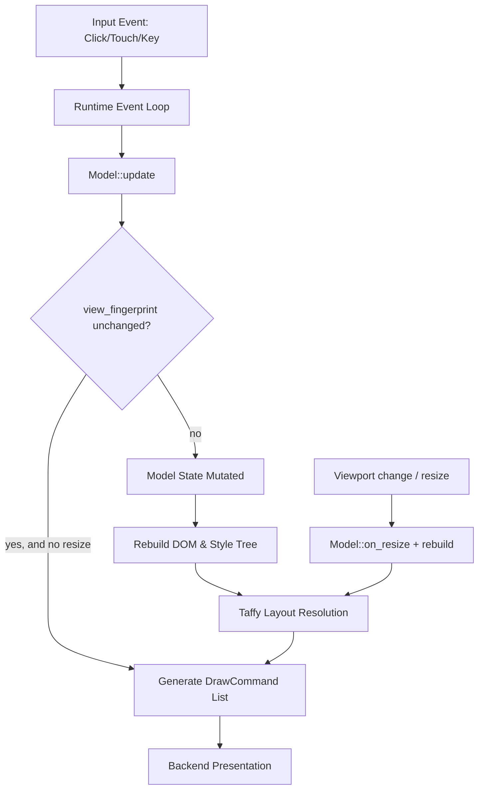

# Xerune Architecture Overview

This document describes the high-level architecture, pipeline flow, and structural design of the Xerune rendering engine.

## Conceptual Framework

Xerune integrates a standard browser-like pipeline (HTML parsing, CSS styling, layout calculation, and graphic drawing) with the Elm/Model-View-Update (MVU) state pattern.

---

## 1. State Management (MVU)

State is strictly isolated inside the `Model` trait:
- **Model**: Custom application state struct.
- **Message**: A user-defined enum containing actions.
- **Context**: Access layer passed to `update` for drawing custom canvases or firing viewport commands.

`update` runs when:
1. Input events arrive from OS backends, and hit-testing matches them to an element with a `data-on-click` (or hover) message.
2. `Runtime::poll` finds timers (`Context::after`), intervals or frames (`Model::subscriptions`) due. Everything due in one poll is handled together, with one rebuild; the returned `Wake` tells the backend when to poll again (the next frame at `target_fps` while something animates, the next timer, or only after input).

After `update`, the runtime rebuilds the view — unless the model opts into **fingerprint gating** (`Model::view_fingerprint` returns `Some(..)`): if the fingerprint is unchanged since the last rebuild and no viewport change occurred, the costly DOM/style/layout rebuild is skipped. Canvas dirty flags and viewport changes always bypass the skip.

**Responsive state**: The active viewport size lives in `src/screen.rs` as two process-global atomics (`screen::width/height/breakpoint`). On a real resize, `Runtime::set_size` updates these, fires `Model::on_resize`, and rebuilds so `@media`/`vw` re-resolve. Fixed-size embedded displays pay nothing beyond two relaxed atomic reads at startup.

---

## 2. Layout & Stylesheet Pipeline

Xerune parses CSS declarations, matching them to nodes via tags, classes, and IDs:
1. **HTML Parsing**: Performed during template generation.
2. **Media & At-Rule Handling**: `xerune_css::sheet` reads `@media` blocks (nested ones too) and records the queries each rule is under; other at-rules are skipped (`@keyframes` is read separately). Queries are parsed in `xerune_css/src/media.rs`. For **compiled templates** (`XeruneTemplate`), the macro emits each such rule behind a `matches_query(&[FeatureGroup])` predicate built from static `Feature` constants — no runtime parsing. For **runtime string stylesheets**, the parsed sheet is cached by its text and each build evaluates its blocks against the viewport once (`StyleSheet::media_matches`), skipping the rules of blocks that don't match. In both, `@media` rules cascade with the others by specificity. Supported features: `min/max-width`, `min/max-height`, `orientation`, and `all`/`screen`, other media types, `not`.
3. **Viewport Units**: `vw`/`vh`/`vmin`/`vmax` lengths resolve against `src/screen.rs`'s global viewport at style-application time (`css::parse_px`).
4. **Style Resolution**: CSS property values are resolved onto `ContainerStyle` values (margins, padding, align-items, flex-direction, colors, borders, font configuration).
5. **Taffy Tree**: Layout properties (display, width, heights, paddings, flex configurations) are sent to a `TaffyTree` representing the DOM layout tree.
6. **Text**: each text node (a run of literal text and `{{ }}` values) is shaped once per build by `TextMeasurer::shape` into a `text::ShapedText`: glyph ids with advances plus its UAX #14 break segments, cached by the measurer by text, size and weight. Its taffy leaf has no fixed size; a measure function answers min-content (widest unbreakable piece), max-content (unbroken line) and the height at a given width with arithmetic over the segments. After layout, each text node's lines are broken at its final width (and cut for `text-overflow: ellipsis`).
7. **StyleCacheKey**: To optimize performance on embedded hardware, resolved styles are cached using tag, class, ID, inherited properties, **and the viewport size** (`vw`/`vh` depend on it) to avoid re-resolution.

---

## 3. Render Pipeline

Once the Taffy tree computes the relative position and dimensions of every element, the runtime performs the drawing pass:
1. **Layout Walk**: The engine walks the Taffy tree depth-first, maintaining absolute offsets.
2. **Command Generation**: Nodes are translated into `DrawCommand` variants:
   - `DrawRect`: Renders solid background colors, gradients, borders, and border-radius properties.
   - `DrawText`: One line of text, carrying its `GlyphRun` (glyph ids and advances from shaping). `xerune_render` blits the glyph ids at their advances; without a run (text inputs) it lays the string out itself.
   - `DrawCheckbox`, `DrawSlider`, `DrawProgress`: Draws native UI primitives.
   - `DrawImage`: Blits raw images.
   - `DrawCanvas`: Blits custom user-drawn Canvas buffers.
3. **Clip Rectangles**: Overflows are restricted by generating `Clip` and `PopClip` commands.
4. **Damage**: `Runtime::render` diffs the commands with the previous frame's (Myers' diff: inserted and removed commands) and repaints only those areas, as a `Damage` of up to 8 rectangles. The first frame, a viewport change and newly loaded images repaint everything.
5. **Execution**: A `Renderer` (normally `xerune_render::SoftwareRenderer`) draws the commands into a `Surface`, one damaged rectangle at a time. A surface has a pixel format, a row stride (a display's pitch), a rotation, and an origin: it can be a band of the screen, so a device without memory for a full frame renders in strips, with the same pixels as a full frame.

---

## 4. Hardware Backends

Xerune implements system integrations specifically designed for low-power Linux environments:
- **Winit Backend**: Provides cross-platform desktop windows and event polling via `softbuffer`.
- **Linux Framebuffer (`/dev/fb0`)**: Direct memory-mapped CPU blitting, supporting raw 16-bit RGB565 or 32-bit ARGB8888, rotation, and hardware double-buffering page flips.
- **DRM/KMS Backend**: Accesses `/dev/dri/cardX`, setting CRTC mode-setting and Dumb Buffers for true hardware page-flipping without a compositor.
- **evdev Touch Calibration**: Automatically maps raw hardware touch coordinates (min/max bounds) onto display logical pixels.
